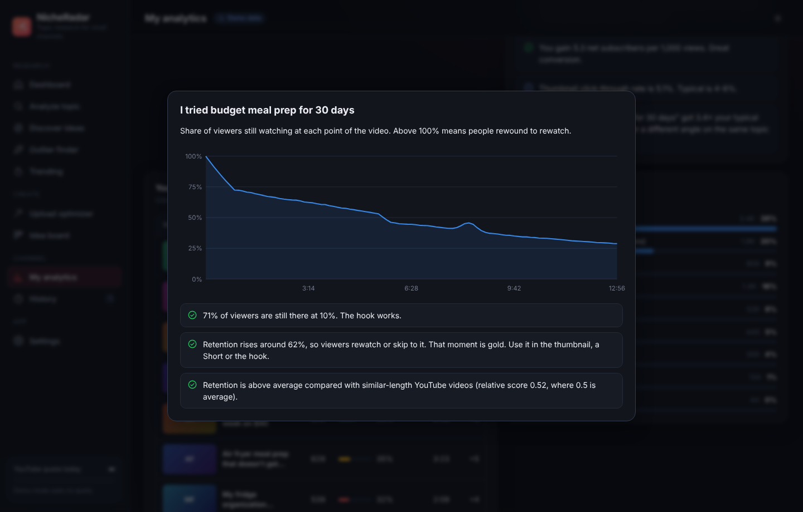

# NicheRadar

Find YouTube topics a small channel can actually win, then upload them right. A Windows desktop app that checks
a video idea against what's ranking on YouTube **before** you film it: who owns the topic, whether small channels
break through, whether there's demand, and which format works. Then it gives you the titles, description, tags and
watch-time plan to upload with.

YouTube tends to recommend the established channel when a small channel makes the same broad video. NicheRadar's
job is to find the topics and angles where it won't.

No accounts and no NicheRadar servers. Your keys and data stay on your PC.


| | What it does |
|---|---|
| **Analyze topic** | A 0-100 Opportunity Score from four signals: demand, small-channel breakouts, how much big channels own the top results, and freshness / content gaps. Includes a verdict, the reasons, the best format (Shorts or long-form), a "who wins this search" chart and the full results table. |
| **Upload playbook** | For every topic: suggested titles, the title patterns winners use, a description template with chapters, tags (under the 500-character limit), 3 hashtags, a target video length, and checklists for click-through, watch time, Shorts and metadata. |
| **Upload optimizer** | Paste your draft title, description and tags to get a score with specific fixes, compared against what wins for that topic. |
| **Discover ideas** | Mines YouTube search suggestions (A-Z, questions, modifiers) around a niche for free, then scores the ones you pick in one go. Also turns hot Reddit threads into topics. |
| **Outlier finder** | Videos from small channels that got many times their subscriber count in the last week, month, quarter or year. |
| **Trending** | YouTube's trending chart by country and category, with small-channel videos and recurring themes highlighted. |
| **My analytics** | Connect YouTube Analytics (read-only) for views, watch time, average % viewed, thumbnail CTR, traffic sources, and each video's **retention curve**, with tips drawn from your own numbers. |
| **AI assistant** (optional) | With an Anthropic API key, Claude turns a report into 5 differentiated angles, ready-to-paste metadata, thumbnail concepts, a pinned comment and a retention plan with a hook script. It can also critique and rewrite your draft. |
| **Idea board** | A drag-and-drop pipeline: Ideas → Researching → Scripting → Filming → Uploaded, with CSV export. |

| Upload playbook | Retention curve from YouTube Analytics |
|---|---|
|  |  |

## Install

**`NicheRadar-Setup-1.0.0.exe`** is the Windows installer (Windows 10 and 11). Get it from the repository's
**Actions** tab (latest *Build* run → *Artifacts* → `NicheRadar-Windows-installer`), or from **Releases** once a
version is tagged. It isn't code-signed, so SmartScreen may say "Windows protected your PC". Click
*More info → Run anyway*.

Want to look around first? NicheRadar opens in **demo mode** with made-up data until you add a key, so every screen
works out of the box.

## First-time setup

1. **Get a free YouTube Data API key** (about 3 minutes, no billing needed). In
   [Google Cloud Console](https://console.cloud.google.com/projectcreate) create a project, enable
   [YouTube Data API v3](https://console.cloud.google.com/apis/library/youtube.googleapis.com), then
   *Credentials → Create credentials → API key*. Paste it into **Settings → YouTube API key** and click *Save*.
   NicheRadar tests it straight away.
2. **Connect your channel** under *Settings → Your channel* (your @handle or channel URL). "Small channel" then
   means channels within reach of yours: 25× your subscribers, between 10K and 250K.
3. **Optional: connect YouTube Analytics** under *Settings → YouTube Analytics* (steps below).
4. **Optional: add an Anthropic API key** under *Settings → AI assistant* for AI angles and rewrites.

### Connecting YouTube Analytics

Your channel's private stats need Google sign-in. You use your own (free) OAuth client, so your data only goes
between your PC and Google:

1. In the same Google Cloud project, enable the
   [YouTube Analytics API](https://console.cloud.google.com/apis/library/youtubeanalytics.googleapis.com).
2. Set up the [OAuth consent screen](https://console.cloud.google.com/auth/branding): choose *External*, then fill in
   the app name and your email.
3. Under *Audience*, add your Google account as a test user, or click **Publish app**. Published apps stay signed
   in; in *Testing* mode Google signs you out every 7 days. Google warns that the app is unverified. That's
   expected for your own personal app: click *Advanced → Continue*.
4. Under [Clients](https://console.cloud.google.com/auth/clients), choose *Create client → Desktop app*. Paste the
   client ID and secret into NicheRadar and click *Save*.
5. Click **Connect YouTube Analytics**. Your browser opens Google sign-in. Pick the account that owns your channel
   and allow read-only access. The browser then says *Connected!* and NicheRadar shows your stats.

## How it works

- **What a score means.** The full method is in [docs/SCORING.md](docs/SCORING.md). In short: a topic scores
  high when people are watching it, small channels already rank or break out in it, big channels don't own the
  top results, and YouTube surfaces new uploads (or the top videos are old). Guard rails keep a topic nobody
  watches from scoring well just because nobody competes.
- **Quota.** A quick scan costs about 102 of your 10,000 daily units; a deep scan (adds the most-viewed uploads of
  the last 90 days) about 204. Trending costs about 2. Finding ideas from search suggestions and Reddit costs
  nothing. The sidebar shows what's left today; quota resets at midnight Pacific time. Results are cached for 12
  hours, and reopening a saved report from History is free.
- **History.** Every report and outlier search is saved, including the AI angles. Reopen, re-run or export it as
  CSV any time.
- **Shorts.** YouTube doesn't say which videos are Shorts, so NicheRadar counts videos of 60 seconds or less, or
  up to 3 minutes tagged #shorts.
- **Thumbnail CTR.** Shown when the YouTube Analytics API provides it for your channel; otherwise check YouTube
  Studio → Reach.

## Privacy and security

- Everything is stored in `%APPDATA%\NicheRadar\data` (*Settings → Data → Open data folder*).
- API keys, the Google client secret and the Google sign-in are encrypted with your Windows account (Windows
  DPAPI through Electron's `safeStorage`). The UI only ever sees a masked hint like `AIza…7890`.
- NicheRadar only talks to Google (YouTube Data and Analytics APIs, search suggestions), Reddit (when you use that
  tab) and Anthropic (only when you click an AI button). Nothing about you is sent anywhere else.
- Google sign-in uses OAuth with PKCE and a one-time loopback address on `127.0.0.1`, in your real browser
  (Google blocks sign-in inside app windows). Access is read-only, and *Disconnect* revokes it.
- The app window is sandboxed with context isolation and a strict Content-Security-Policy. The page can only call
  a fixed list of engine methods, and links always open in your browser.

## Project layout

```
desktop/                Electron + React + TypeScript Windows app
  src/core/             engine shared by the app and the browser demo: scoring, playbook, YouTube client,
                        analytics, idea sources, storage, demo data
  src/main/             Electron main process: window, IPC, encrypted storage, Google sign-in, Claude
  src/renderer/         React UI (pages, charts, components)
  scripts/              dev server, build, selftest, icon generator
docs/                   How scoring works
release/                Built installers
.github/workflows/      CI: tests on Linux, Windows installer on Windows
```

## Building from source

**Windows app** (Node 22+):

```
cd desktop
npm install
npm run dev          # run with hot reload
npm run web          # UI only, in a browser, on demo data
npm run dist         # build the installer into desktop/dist-installer
```

`npm run start` builds and opens the app without the dev server. `npm run icon` redraws the app icon (needs
Python with Pillow).

## Tests

| Command | What it checks |
|---|---|
| `npm run selftest` (in `desktop/`) | End-to-end checks of the engine on demo and synthetic data: duration and Shorts parsing, breakout detection, scores for big-channel-owned, breakout and no-demand topics, content gaps, the auto small-channel threshold, the upload playbook, the draft checker, every engine operation in demo mode, ideas and history, secrets never reaching the UI, encrypted disk storage with cache expiry and the quota ledger, analytics and retention insights, and the OAuth PKCE request |
| `npm run typecheck` (in `desktop/`) | TypeScript across the engine, main process, UI and tests |

CI runs both on every push and builds the Windows installer.
