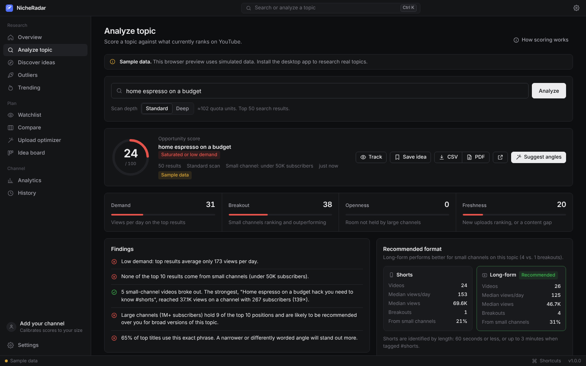
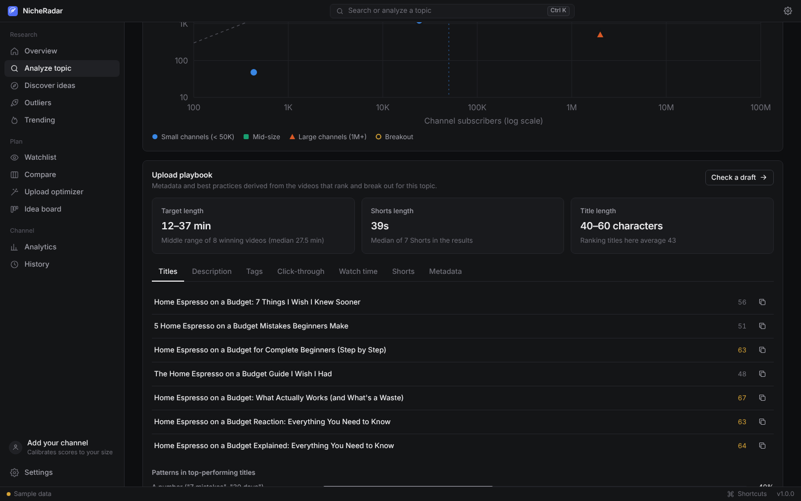
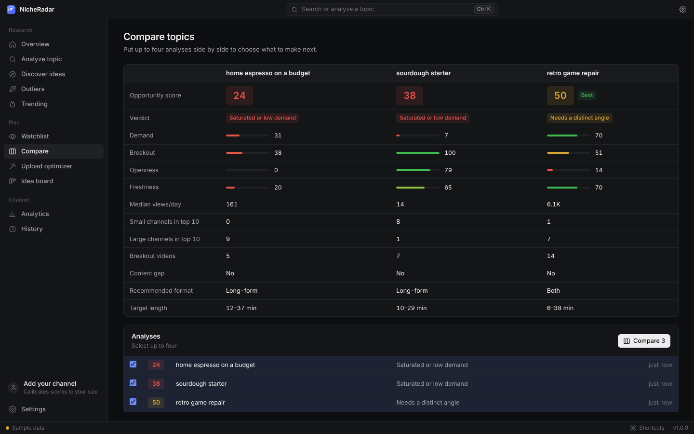

# NicheRadar

A Windows desktop app for YouTube topic research. NicheRadar checks a video idea against what currently ranks on
YouTube **before** you film it: how much demand there is, whether smaller channels break through, how much of the
search large channels hold, and which format performs better. It then gives you the titles, description, tags and
retention plan to publish with.

Large channels tend to be recommended over small ones for the same broad video. NicheRadar is built to find the
topics and angles where that isn't the case.

No accounts and no NicheRadar servers. Your keys and data stay on your computer.



## Features

| | |
|---|---|
| **Analyze topic** | A 0-100 opportunity score from demand, small-channel breakouts, large-channel dominance and freshness, with findings, a format recommendation, a channel-size vs. views chart and the full results table. Export as CSV or PDF. |
| **Upload playbook** | Titles, title patterns, a description template with chapters, tags within YouTube's 500-character limit, hashtags, target length, and click-through, watch-time, Shorts and metadata checklists, all derived from the videos that rank for the topic. |
| **Upload optimizer** | Scores a draft title, description and tags with specific fixes, using topic benchmarks when the keyword has been analyzed. |
| **Watchlist** | Track topics and re-score them over time, with trend lines and score changes. |
| **Compare** | Up to four analyses side by side. |
| **Discover ideas** | Mines YouTube search suggestions (A–Z, questions, modifiers) around a niche at no quota cost, then batch-scores the phrases you select. Also turns popular Reddit threads into topics. |
| **Outliers** | Recent small-channel videos that earned many times their subscriber count. |
| **Trending** | YouTube's trending chart by country and category, with small-channel videos highlighted. |
| **Analytics** | Connect YouTube Analytics (read-only) for views, watch time, average percentage viewed, click-through rate, traffic sources and per-video audience retention, with insights from your own numbers. |
| **AI assistant** (optional) | With an Anthropic API key, Claude proposes differentiated angles, ready-to-use metadata, thumbnail concepts and a retention plan, and can review a draft. |
| **Idea board** | A drag-and-drop production pipeline with CSV export. |

Also included: a command palette (<kbd>Ctrl</kbd>+<kbd>K</kbd>), keyboard shortcuts for every section, first-run setup,
system/light/dark themes, automatic updates, and a status bar showing data source and remaining quota.

| Upload playbook | Compare topics |
|---|---|
|  |  |

## Install

**`NicheRadar-Setup-1.0.0.exe`** is the Windows installer (Windows 10 and 11). Get it from the repository's
**Actions** tab (latest *Build* run → *Artifacts* → `NicheRadar-Windows-installer`), or from **Releases** once a
version is tagged. It isn't code-signed, so SmartScreen may say "Windows protected your PC". Click
*More info → Run anyway*.

On first launch a short setup asks for a YouTube Data API key and your channel. You can skip it and explore with
sample data; every screen works without a key.

## First-time setup

1. **Get a free YouTube Data API key** (about 3 minutes, no billing needed). In
   [Google Cloud Console](https://console.cloud.google.com/projectcreate) create a project, enable
   [YouTube Data API v3](https://console.cloud.google.com/apis/library/youtube.googleapis.com), then
   *Credentials → Create credentials → API key*. Paste it into **Settings → YouTube API key** and click *Save*.
   NicheRadar tests it straight away.
2. **Connect your channel** under *Settings → Your channel* (your @handle or channel URL). "Small channel" then
   means channels within reach of yours: 25× your subscribers, between 10K and 250K.
3. **Optional: connect YouTube Analytics** under *Settings → YouTube Analytics* (steps below).
4. **Optional: add an Anthropic API key** under *Settings → AI assistant* for AI angles and rewrites.

### Connecting YouTube Analytics

Your channel's private stats need Google sign-in. You use your own (free) OAuth client, so your data only goes
between your PC and Google:

1. In the same Google Cloud project, enable the
   [YouTube Analytics API](https://console.cloud.google.com/apis/library/youtubeanalytics.googleapis.com).
2. Set up the [OAuth consent screen](https://console.cloud.google.com/auth/branding): choose *External*, then fill in
   the app name and your email.
3. Under *Audience*, add your Google account as a test user, or click **Publish app**. Published apps stay signed
   in; in *Testing* mode Google signs you out every 7 days. Google warns that the app is unverified. That's
   expected for your own personal app: click *Advanced → Continue*.
4. Under [Clients](https://console.cloud.google.com/auth/clients), choose *Create client → Desktop app*. Paste the
   client ID and secret into NicheRadar and click *Save*.
5. Click **Connect YouTube Analytics**. Your browser opens Google sign-in. Pick the account that owns your channel
   and allow read-only access. The browser then says *Connected!* and NicheRadar shows your stats.

## Keyboard shortcuts

| Shortcut | Action |
|---|---|
| <kbd>Ctrl</kbd>+<kbd>K</kbd> | Command palette: analyze a topic, jump to a page or reopen a report |
| <kbd>/</kbd> | Focus the search box |
| <kbd>Ctrl</kbd>+<kbd>1</kbd>–<kbd>9</kbd> | Go to a section |
| <kbd>Ctrl</kbd>+<kbd>,</kbd> | Settings |
| <kbd>Ctrl</kbd>+<kbd>/</kbd> | Show all shortcuts |

## How it works

- **What a score means.** The full method is in [docs/SCORING.md](docs/SCORING.md). In short: a topic scores
  high when people are watching it, small channels already rank or break out in it, large channels don't hold the
  top results, and YouTube surfaces new uploads (or the top videos are old). Guard rails keep a topic nobody
  watches from scoring well just because nobody competes.
- **Quota.** A quick scan costs about 102 of your 10,000 daily units; a deep scan (adds the most-viewed uploads of
  the last 90 days) about 204. Trending costs about 2. Finding ideas from search suggestions and Reddit costs
  nothing. The sidebar shows what's left today; quota resets at midnight Pacific time. Results are cached for 12
  hours, and reopening a saved report from History is free.
- **History.** Every report and outlier search is saved, including AI suggestions. Reopen, re-run, compare or export
  any of them.
- **Watchlist.** Re-scoring a tracked topic runs a standard scan and records the score, so you can see whether an
  opportunity is opening up or closing.
- **Updates.** The installed app checks GitHub Releases at startup (can be turned off in Settings), downloads new
  versions in the background and installs them when you restart.
- **Shorts.** YouTube doesn't say which videos are Shorts, so NicheRadar counts videos of 60 seconds or less, or
  up to 3 minutes tagged #shorts.
- **Thumbnail CTR.** Shown when the YouTube Analytics API provides it for your channel; otherwise check YouTube
  Studio → Reach.

## Privacy and security

- Everything is stored in `%APPDATA%\NicheRadar\data` (*Settings → Data → Open data folder*).
- API keys, the Google client secret and the Google sign-in are encrypted with your Windows account (Windows
  DPAPI through Electron's `safeStorage`). The UI only ever sees a masked hint like `AIza…7890`.
- NicheRadar only talks to Google (YouTube Data and Analytics APIs, search suggestions), Reddit (when you use that
  tab) and Anthropic (only when you click an AI button). Nothing about you is sent anywhere else.
- Google sign-in uses OAuth with PKCE and a one-time loopback address on `127.0.0.1`, in your real browser
  (Google blocks sign-in inside app windows). Access is read-only, and *Disconnect* revokes it.
- The app window is sandboxed with context isolation and a strict Content-Security-Policy. The page can only call
  a fixed list of engine methods, and links always open in your browser.

## Project layout

```
desktop/                Electron + React + TypeScript Windows app
  src/core/             engine shared by the app and the browser demo: scoring, playbook, YouTube client,
                        analytics, idea sources, storage, demo data
  src/main/             Electron main process: window, IPC, encrypted storage, Google sign-in, PDF export,
                        updates, Claude
  src/renderer/         React UI (pages, charts, components)
  scripts/              dev server, build, selftest, icon generator
docs/                   How scoring works
release/                Built installers
.github/workflows/      CI: tests on Linux, Windows installer on Windows
```

## Building from source

**Windows app** (Node 22+):

```
cd desktop
npm install
npm run dev          # run with hot reload
npm run web          # UI only, in a browser, on demo data
npm run dist         # build the installer into desktop/dist-installer
```

`npm run start` builds and opens the app without the dev server. `npm run icon` redraws the app icon (needs
Python with Pillow).

## Tests

| Command | What it checks |
|---|---|
| `npm run selftest` (in `desktop/`) | End-to-end checks of the engine on demo and synthetic data: duration and Shorts parsing, breakout detection, scores for big-channel-owned, breakout and no-demand topics, content gaps, the auto small-channel threshold, the upload playbook, the draft checker, every engine operation in demo mode, the watchlist, ideas and history, secrets never reaching the UI, encrypted disk storage with cache expiry and the quota ledger, analytics and retention insights, and the OAuth PKCE request |
| `npm run typecheck` (in `desktop/`) | TypeScript across the engine, main process, UI and tests |

CI runs both on every push and builds the Windows installer.
